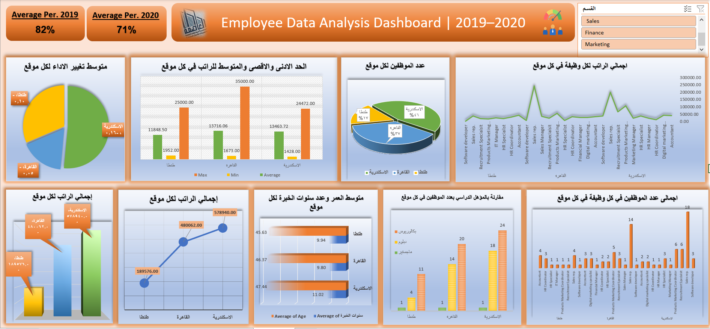

# Employee Data Analysis & HR Dashboard

## Project Overview
This project focuses on analyzing employee data using Microsoft Excel. The goal was to organize and analyze employee information across different departments and present key insights through reports and an interactive dashboard.

## Dataset
The dataset includes employee information from five departments:
- Sales
- Marketing
- IT
- HR
- Finance

The project uses a training dataset provided as part of a Data Analysis course.

## Project Workflow
1. **Data Consolidation:** Combined employee data from different department sheets into one consolidated sheet named `Employee Data`.
2. **Data Cleaning & Preparation:** Prepared and organized the data for analysis using Power Query.
3. **Data Analysis:** Used PivotTables to summarize employee information and explore different aspects of the workforce.
4. **Dashboard Creation:** Built an Excel dashboard containing 9 charts to present the analysis visually.

## Analysis Areas
The report and dashboard explore:
- Employee distribution by department and location.
- Employee counts by job title and education level.
- Salary analysis.
- Average employee age and years of experience.
- Employee performance comparison between 2019 and 2020.
- Highest and lowest performance results.

## Tools & Skills
- Microsoft Excel
- Power Query
- Data Cleaning
- PivotTables
- Charts & Dashboard Design

## Project Files
- `Final Project (Excel).xlsx` — Includes the original data, consolidated employee data, analysis report, and dashboard.

## Key Takeaway
This project demonstrates my ability to prepare, organize, analyze, and visualize data using Excel, turning raw employee information into a structured report and dashboard.

## Dashboard Preview

